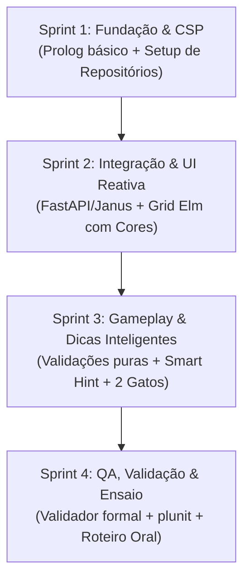

# Plano de Ação e Cronograma de Execução: Meowdoku

**Meta de Entrega:** Lote 1 (18/11/2026 às 23h59) — Nota integral sem penalidades de prazo.  
**Meta de Escopo:** Categoria *Remix Original* com bônus $\Delta = +0{,}5$ na nota do grupo ($G$).

---

## 1. Cronograma em 4 Sprints



### Sprint 1: Fundação & CSP (Dias 1 e 2)
* [x] Criação da organização GitHub `Paradigmas-Grupo01` e repositórios `meow-Game` e `Meow-Docs`.
* [x] Implementação da modelagem CSP inicial em Prolog (`backend/prolog/meowdoku.pl`).
* [x] Criação da primeira suite de testes com `plunit` (`backend/prolog/test_meowdoku.pl`).
* [x] Configuração da ponte Python/FastAPI (`backend/app/meowdoku_prolog.py` e `backend/app/main.py`).

### Sprint 2: Frontend Elm & Conexão Inicial (Dias 3 e 4)
* [x] Modelagem dos tipos e regras puras em Elm (`frontend/src/Meowdoku.elm`).
* [x] Criação dos decoders e encoders HTTP (`frontend/src/Api.elm`).
* [ ] Implementação da tela do tabuleiro no `frontend/src/Main.elm` renderizando células com classes de cor por região.
* [ ] Tratamento dos eventos de clique (ciclando Vazio $\to$ X $\to$ Gato $\to$ Vazio).
* [ ] Conectar o botão "Resolver" para receber a solução do Prolog via API.

### Sprint 3: Mecânicas Originais & Gameplay (Dias 5 e 6)
* [ ] Adicionar o seletor de dificuldade / modo de jogo (Clássico 1 Gato vs. Modo Avançado 2 Gatos).
* [ ] Renderizar o componente de *Smart Feline Hint* na interface, exibindo a justificativa lógica gerada pelo Prolog.
* [ ] Implementar atalhos de teclado (ex: tecla `X` para marcar descarte, tecla `G` para marcar gato).
* [ ] Validação visual instantânea no Elm (destacar em vermelho células com conflito de vizinhança ou excesso de gatos na linha/coluna/cor).

### Sprint 4: QA, Validação Formal e Relatório (Dias 7 e 8)
* [ ] Rodar o validador oficial na raiz de `meow-Game`:
  ```sh
  uv run scripts/validar_entrega.py RELATORIO.md
  ```
* [ ] Garantir 100% de aprovação na suite de testes do Prolog (`swipl -g run_tests -t halt backend/prolog/test_meowdoku.pl`).
* [ ] Formatar o código Elm com `elm-format`.
* [ ] Preencher as Seções 1 a 13 do `RELATORIO.md` de acordo com a contribuição real de cada membro.
* [ ] Cada integrante preenche sua avaliação individual em `avaliacao-360/<matricula>.md`.
* [ ] Ensaio cronometrado da apresentação de 15 minutos.
